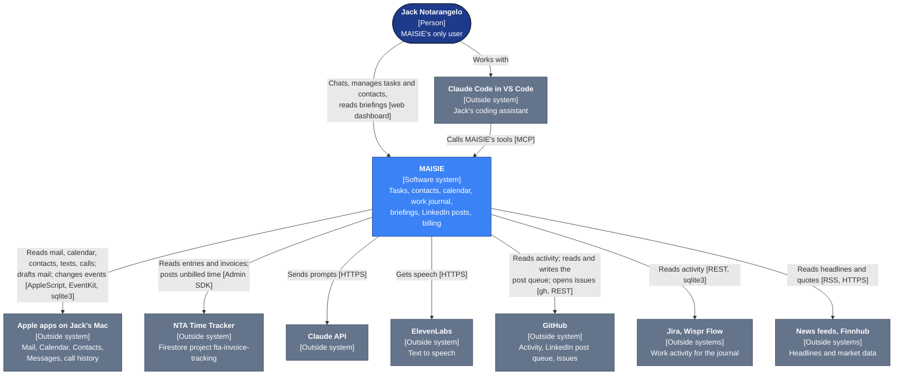
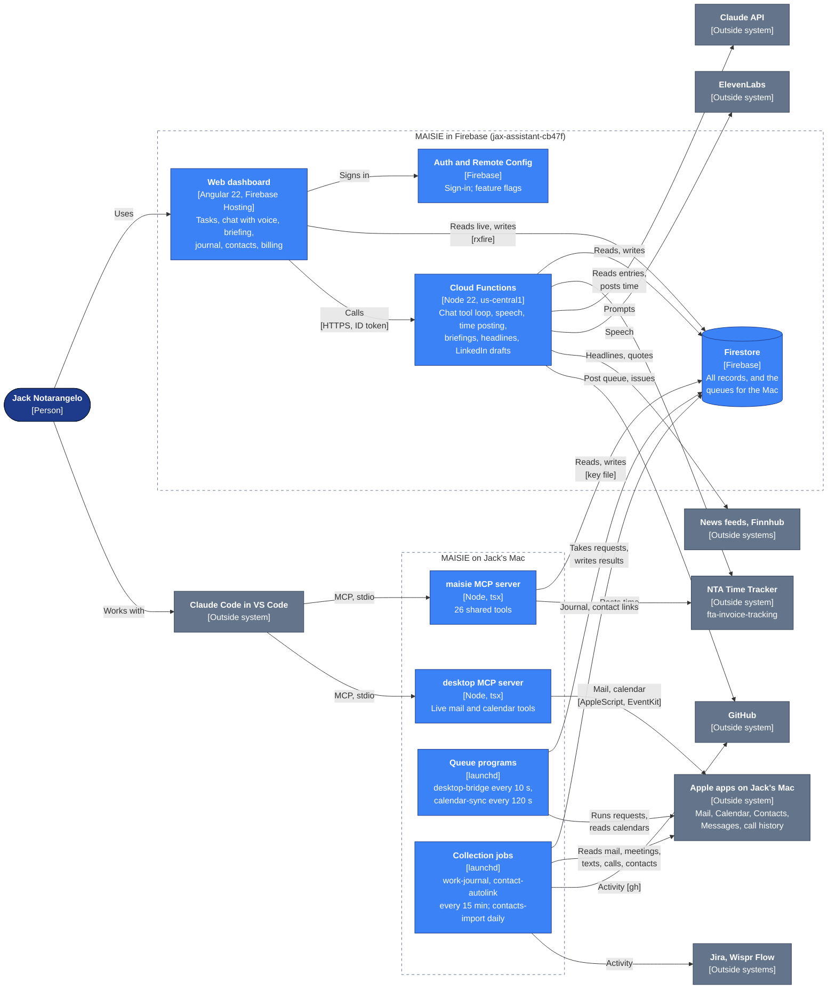

# MAISIE — Tech Stack & Architecture

> **Last checked against the code**: 2026-10-27
> **Status**: Authoritative reference. Keep it in step with the code. See [Keeping This Doc Updated](#keeping-this-doc-updated).

MAISIE is Jack Notarangelo's personal assistant. It has one user. Jack reaches it three ways: the web dashboard, VS Code (through two local MCP servers), and schedules that run on their own. SMS was removed on 2026-10-27. It manages tasks, contacts, the calendar, a work journal, daily briefings, LinkedIn posts, and billing against the NTA Time Tracker.

**For the domain view**, see the [context map](context-map.html): the nine areas, the outside systems, and how each pair connects. This document covers the technical view: the C4 diagrams, stack, structure, data, functions, Mac programs, CI and local setup. It does not repeat the context map.

---

## C4 Diagrams

These are the C4 Context and Container views (see `docs/standards/documentation.md`). Navy is a person, blue is MAISIE, and grey is an outside system.

### System Context



### Containers

The Mac containers sign in with `bridge/service-account.json` (see [Known Gaps](#known-gaps)). Schedules run inside Cloud Functions, triggered by Cloud Scheduler.



---

## Tech Stack

| Layer | Technology | Version |
|---|---|---|
| Framework | Angular, standalone components, `application` builder | 22.2.1 |
| Language | TypeScript (web app) / TypeScript (functions and bridge) | 6.0.3 / 5.9.3 |
| Change detection | `zone.js` with `provideZoneChangeDetection({ eventCoalescing: true })` | 0.15.1 |
| Firebase (browser) | Firebase JS SDK with `rxfire`; no AngularFire | 11.10.0 / 6.2.0 |
| Firebase (server) | `firebase-admin` / `firebase-functions` (2nd generation) | 12.7.0 / 6.6.0 |
| AI | Anthropic SDK `@anthropic-ai/sdk` | 0.115.0 |
| Models (`functions/src/model.ts`) | `MODEL` for chat, LinkedIn drafts and invoice descriptions; `LIGHT_MODEL` for briefings and headlines | `claude-sonnet-5-5` / `claude-haiku-5-5` |
| Voice | ElevenLabs text-to-speech through `fetch` | `eleven_turbo_v2_5` |
| MCP | `@modelcontextprotocol/sdk`, run with `tsx` | 1.30.0 |
| Markdown | `marked` | 17.0.4 |
| Tests | Karma + Jasmine, `node:test`, `@firebase/rules-unit-testing`, on the Firebase emulators | Karma 6.4.4 |
| Runtime | Node.js 22 for builds, CI and Cloud Functions | 22 |
| Hosting | Firebase Hosting | — |

`AGENTS.md` explains why MAISIE uses two models, an exception to `docs/standards/ai-features.md`.

---

## Project Structure

| Folder | What it holds |
|---|---|
| `src/` | The Angular app (see below) |
| `functions/src/` | Cloud Functions (`index.ts`), shared tools (`tools/`), the time tracker client (`fta-client.ts`), briefing, headlines and LinkedIn modules |
| `functions/src/mcp/` | Local-only code: the `maisie` MCP server and the Mac scripts (contacts, journal). Not deployed. |
| `bridge/` | Mac programs, launchd plists, AppleScript and EventKit helpers, the `desktop` MCP server, bridge tests |
| `tests/` | Node test suites: `functions/`, `mcp/`, `rules/`, `site/` |
| `docs/` | `architecture/` (this document and the context map); `standards/` (copy of the shared standards; do not edit here) |
| `context/`, `decisions/`, `projects/`, `references/`, `templates/`, `archives/` | The assistant's working material: context about Jack, the decision log, workstreams, templates, retired material |
| `.claude/` | Assistant skills (7) and rules |
| `public/` | Icons, logos, `greeting.mp3` |
| `.github/workflows/` | CI/CD (see below) |

`src/app/`:

- `components/`: `dashboard` (tasks, chat, briefing, headlines, LinkedIn card, billing), `journal` (with the post-time panel and the timeline of work and breaks), `contacts`, `login`.
- `services/`: one service per area (see [Key Services](#key-services)).
- `models/`: 10 interface files.
- `firebase.ts`: injection tokens for the Firebase SDK objects.

---

## Architecture

### How the parts connect

See the [Containers](#containers) diagram.

### Routing

All routes load lazily: `/login`, `/contacts`, `/journal` and `/` (dashboard). No route has a guard. An `effect()` in `app.component.ts` sends a signed-out user to `/login`. The real protection is in the Firestore rules and in the ID token check in each function.

### Firebase access in the web app

- `src/app/firebase.ts` defines the tokens `FIREBASE_APP`, `AUTH`, `FIRESTORE` and `REMOTE_CONFIG`, created by `provideFirebase()`.
- Sign-in is email and password.
- Live reads use `rxfire` (`docData`, `collectionData`).
- The app calls functions through their Cloud Run URLs (`https://<name>-nxe253ex3a-uc.a.run.app`), sending the ID token as a Bearer header.

### Key Services

| Service | Responsibility |
|---|---|
| `auth.service` | Auth state as signals; sign in and out; ID token |
| `chat.service`, `chat-session.service` | Sends a message to the `chat` function; streams messages and the "thinking" step; manages sessions |
| `task.service`, `task-category.service` | Tasks and categories, with repeat rules (`recurrence.ts`) |
| `contact.service` | Contacts, companies, notes, links and dismissed links |
| `journal.service` | Work journal days and items; moves items between clients |
| `briefing.service`, `alert.service`, `calendar.service` | Briefing and headlines, alerts, the calendar mirror |
| `linkedin.service` | The weekly LinkedIn post card |
| `billing.service`, `time-tracker.service` | Unbilled summary; posting time to the NTA Time Tracker |
| `tts.service`, `stt.service` | ElevenLabs speech (cached per sentence in IndexedDB); browser speech recognition |
| `feature-flag.service` | Remote Config flags: voice input, speech, billing tab, calendar sync, voice choice |

---

## Firestore Collections

"Signed in" means `request.auth != null`. There is no per-user check, because MAISIE has one user. Every collection not listed is denied.

| Collection | Holds | Web app access (`firestore.rules`) | Written by |
|---|---|---|---|
| `tasks`, `taskCategories` | Tasks with due date and repeat rule; categories | Read and write when signed in | Web app, tools |
| `chatSessions` | Session title and last message | Read and write when signed in | Web app, `chat` |
| `chatMessages`, `chatThinking/{sessionId}` | Messages in order; the current tool step | Read (and delete messages) | `chat` |
| `contacts`, `companies`, `contactNotes`, `contactLinks`, `contactLinkDismissals` | People, companies, notes, and links to emails, meetings, texts and calls | Read and write when signed in | Web app, tools, Mac contacts jobs |
| `journal`, `journalDays/{YYYY-MM-DD}` | Work journal items and daily totals per client | Read only | Mac work-journal job, `journalItems` |
| `briefings` | `live`, `headlines`, and dated archives | Read only | Briefing and headlines functions |
| `alerts` | Alerts such as the invoice reminder | Read and dismiss | `invoiceReminder` |
| `calendarEvents` | Mirror of the next 7 days of 7 Apple calendars | Read only | `calendar-sync` on the Mac |
| `pendingCalendarActions` | Calendar create and move requests | Read only | Tools; applied by `calendar-sync` |
| `pendingDesktopActions` | Mail search, read and draft, and spoken alerts | Read only | Tools and `onCalendarChange`; applied by `desktop-bridge` |
| `linkedin/week` | This week's post: stage, draft, status | Read only | LinkedIn functions |
| `memories` | Up to 50 standing instructions for the assistant | Read only | Tools |
| `metadata` | Job state: calendar sync and change, journal, contact import and auto-link | Denied | Mac programs and functions (Admin SDK) |
| `pendingCodingTasks` | Legacy queue; nothing writes it | Read only | — |

### Cross-project access to the NTA Time Tracker

`functions/src/fta-client.ts` opens a second Admin app for the project `fta-invoice-tracking`. It reads `timeEntries`, `invoices`, active `customers` and active `projects`, and writes new `timeEntries` (status `unbilled`, `source: "maisie"`). In the cloud, it uses the functions' runtime service account. On the Mac, the `maisie` MCP server uses the key in `bridge/service-account.json`. Both accounts need `roles/datastore.user` in `fta-invoice-tracking`.

---

## Cloud Functions

All functions are in `us-central1`. There are no `onCall` functions: every HTTP function is `onRequest` with `cors: true` and checks the Firebase ID token itself. Secrets come from `functions/.env`, written by CI.

| Function | Trigger | What it does |
|---|---|---|
| `chat` | HTTPS, 300 s | The assistant: a tool loop on `MODEL` with adaptive thinking, prompt caching, web search and fetch |
| `synthesizeSpeech` | HTTPS | ElevenLabs speech, returned as MP3 |
| `getUnbilledSummary` | HTTPS | Unbilled time and the last invoice from the time tracker |
| `timeEntries` | HTTPS, 120 s | Time for a day: read, draft descriptions (`MODEL`), post to the time tracker |
| `journalItems` | HTTPS | Moves journal items to another client and rebuilds the days |
| `refreshBriefing` | HTTPS | Builds the briefing now (dashboard button) |
| `morningBriefing` | Schedule, 07:00 and 13:00 ET, weekdays | Builds and archives the briefing |
| `refreshBriefingFacts` | Schedule, every 30 min 06:00–20:00 ET, weekdays | Refreshes the briefing facts |
| `onCalendarChange` | Firestore write to `metadata/calendarChange` | Updates the briefing and queues a spoken alert for the Mac |
| `headlinesBriefing`, `headlinesMarketOpen` | Schedule, 06:45 and 12:45 ET daily; 09:45 ET weekdays | News feeds and market data, chosen by `LIGHT_MODEL` |
| `linkedinRefresh`, `linkedinDraft` | Schedule (daily; Thursday) | Reads the post queue from the `fractional-tech-advisory` repo and drafts next Tuesday's post |
| `linkedinAction` | HTTPS | Dashboard card actions for the post |
| `invoiceReminder` | Schedule, 09:00 ET, days 5–7 | Raises an alert when last month is not yet invoiced |

Environment variable names: `ANTHROPIC_API_KEY`, `ELEVENLABS_API_KEY`, `FINNHUB_API_KEY`, `LINKEDIN_QUEUE_PAT`, `MAISIE_PAT`.

### Tools

- **One implementation per tool.** `functions/src/tools/definitions.ts` defines 35 tools, and `execute.ts` runs them. The `chat` function adds 2 server-side web tools, so the cloud chat sees 37.
- **Shared with VS Code.** The `maisie` MCP server (`functions/src/mcp/server.ts`) uses the same tools: 24 of the 35, plus `get_maisie_context` and `import_apple_contacts`, so 26 in total. The 11 tools that need the cloud or the Mac queue are left out. They are the calendar tools, the mail tools, the 4 LinkedIn tools and `code_with_github`; in VS Code the `desktop` server covers mail and calendar directly.
- **Queued actions.**
  - Calendar create and move go to `pendingCalendarActions`.
  - Mail search, read and draft go to `pendingDesktopActions`. The tool then waits up to 90 seconds for the Mac to answer.
  - The cloud never sends mail.
- **`code_with_github`** drafts a story and one subtask, with the brief headings, for the NTA story agent (`functions/src/tools/story-draft.ts`). It never adds `story-ready`: Jack reads the subtask and adds it to start the agent.

---

## Mac Programs (`bridge/` and `functions/src/mcp/`)

The Mac programs run under launchd with `npx tsx`. They sign in to Firebase with `bridge/service-account.json`, and certificate checks are on.

| launchd label | Runs | Interval | Log |
|---|---|---|---|
| `com.notarangelo.desktop-bridge` | `bridge/desktop-bridge.ts`: applies `pendingDesktopActions` (mail, speech) | 10 s | `/tmp/desktop-bridge.log` |
| `com.notarangelo.calendar-sync` | `bridge/calendar-sync.ts`: mirrors 7 calendars through EventKit; applies `pendingCalendarActions` | 120 s | `/tmp/calendar-sync.log` |
| `com.notarangelo.work-journal` | `functions/src/mcp/collect-journal.ts`: builds the work journal from Mail, meetings, Messages, calls, GitHub, Jira, Claude Code and Wispr Flow | 900 s | `/tmp/work-journal.log` |
| `com.notarangelo.contact-autolink` | `functions/src/mcp/autolink-contacts.ts`: links emails, meetings and texts to contacts | 900 s | `/tmp/contact-autolink.log` |
| `com.notarangelo.contacts-import` | `functions/src/mcp/import-contacts.ts`: imports iCloud contacts | daily 06:00 | `/tmp/contacts-import.log` |
| `com.notarangelo.coding-bridge` | `bridge/coding-bridge.ts`: legacy, replaced by the desktop bridge; not loaded | 30 s | `/tmp/coding-bridge.log` |

- **The `desktop` MCP server** (`bridge/mcp/desktop-server.ts`) gives VS Code 7 live tools with no queue: `calendar_read`, `calendar_create`, `calendar_move`, `mail_search`, `mail_read`, `mail_draft` and `mail_send`.
- **Mac permissions.** Calendar reads need EventKit "Full Access to Calendars". This is separate from the Automation permission that the writes use.
- **Other tools.** `npm run queue` in `bridge/` shows the desktop queue live.

---

## Firebase Configuration

| Setting | Value |
|---|---|
| Project | `jax-assistant-cb47f` |
| App URL | https://jax-assistant-cb47f.web.app |
| Build output | `dist/jax-assistant-app/browser` |
| Hosting | All paths rewrite to `/index.html`. `index.html` is `no-cache`; JS and CSS are cached for a year (`immutable`). A tab opened before a deploy asks for page scripts that no longer exist and gets `index.html` back, so `src/app/stale-chunk.ts` reloads the page the user asked for (at most once per 10 seconds per address). |
| Functions runtime | Node.js 22, region `us-central1` |
| Emulators | Auth 9099, Firestore 8080, single project mode, UI off |

---

## CI/CD Pipeline

| Workflow | When | What it does |
|---|---|---|
| `deploy-and-release.yml` | Push to `main` (every `git ship`), or run by hand | `version` → `test` (calls `tests.yml`) and `build` at the same time → `deploy` → `release-notes` → `create-release`. `deploy` waits for both. One deploy at a time. |
| `tests.yml` | Every pull request, and before every deploy | Runs `test:ci`, `test:site`, `test:rules`, `test:functions`, `test:mcp` (after type-checking the MCP code) and `test:bridge`, each in its own job at the same time. A last job, `Run tests`, passes only when all six pass; the `main` ruleset and the story agent require it by that name. |
| `run-headlines.yml` | By hand only | Runs the headlines schedule job now |

- **Deploy job.** It installs `firebase-tools@15.6.0` and signs in with Workload Identity Federation (`WIF_PROVIDER`, `WIF_SERVICE_ACCOUNT`). It then writes every function secret into `functions/.env` and runs `firebase deploy --only hosting,firestore,functions`.
- **Release notes** come from the Claude API (`claude-sonnet-4-6`). If the call fails, the commits are grouped by type instead.
- **Never deploy from a laptop.** Certificate checks stay on in CI.

---

## Testing

| Script | What it runs | Emulator project | Tests (about) |
|---|---|---|---|
| `test` / `test:ci` | Karma on the Auth and Firestore emulators | `demo-jax-browser` | 115 |
| `test:site` | Static checks of templates, SCSS and icons | none | 16 |
| `test:rules` | Firestore rules | `demo-jax-rules` | 18 |
| `test:functions` | The shared tools and functions code | `demo-jax-test` | 203 |
| `test:mcp` | The `maisie` MCP server as a VS Code client sees it | `demo-jax-mcp` | 62 |
| `test:bridge` | AppleScript helpers (3 skip off macOS) | none | 6 |
| `test:all` | All of the above. Run before `git ship`. | | about 420 |

Helpers: `src/testing/emulator-testing.ts` (browser) and `tests/functions/helpers.mjs` (runs the compiled tools against the emulator). `AGENTS.md` says which suite a change needs tests in.

---

## Design

`src/styles.scss` holds the reset, the system font stack and the dark background (`#0f172a`, text `#f8fafc`). There is no shared token file: each component stylesheet declares its own SCSS colour variables (`$bg-dark`, `$bg-card`, `$accent: #3b82f6`, and so on).

---

## Local Development

```bash
npm start
# App: http://localhost:4200 — it calls the LIVE functions and Firestore
```

```bash
npm run test:all
# Every test suite, on the emulators
```

- **MCP servers.** A gitignored `.mcp.json` at the repo root starts the two servers for Claude Code:
  - `maisie`: `npx tsx src/mcp/server.ts` in `functions/`
  - `desktop`: `npx tsx mcp/desktop-server.ts` in `bridge/`
- **Testing the servers.** `cd functions && npm run mcp` or `cd bridge && npm run mcp:desktop`.
- **What they need.** Both need `bridge/service-account.json` and the macOS Automation and Calendar permissions.

---

## Known Gaps

These were found when this document was written on 2026-10-27. Each needs a decision before it is changed.

- **The docs give old timings for the desktop bridge.** The README and context map say it polls every 30 seconds and the cloud waits 40. The code polls every 10 seconds and waits 90.
- **The tool counts in the docs are wrong.** The README and a comment in `definitions.ts` say 4 cloud tools are missing from VS Code; the real number is 11. The README tool table also leaves out `move_journal_items`.
- **`npm start` uses the live project.** Function URLs are written into the code, and `useEmulators` is `false`.
- **The invoice reminder schedule may run more often than intended.** Its comment says "first 7 days of the month". The cron `0 9 5-7 * 1-5` sets both day fields, so under unix-cron rules it may also run on every weekday. Its guards stop duplicate alerts.
- **The coding bridge has not been removed.** Its plist, the `pendingCodingTasks` rule and index are still in the repo, but nothing writes to that queue.
- **The Mac programs use a key file.** `bridge/service-account.json` goes against `docs/standards/security.md`.
- **`version.ts` is not used.** CI writes `src/environments/version.ts`, but nothing in `src` imports it.

---

## Key File Reference

| File | Purpose |
|---|---|
| `functions/src/index.ts` | All Cloud Functions |
| `functions/src/model.ts` | `MODEL` and `LIGHT_MODEL` |
| `functions/src/tools/definitions.ts`, `execute.ts` | Tool definitions and the tool executor |
| `functions/src/tools/context.ts` | The assistant persona and system prompt |
| `functions/src/fta-client.ts` | Cross-project access to the NTA Time Tracker |
| `functions/src/mcp/server.ts` | The `maisie` MCP server |
| `bridge/desktop-bridge.ts`, `bridge/calendar-sync.ts` | The two main Mac programs |
| `bridge/mcp/desktop-server.ts` | The `desktop` MCP server |
| `firestore.rules` | Security rules |
| `src/app/firebase.ts` | Firebase injection tokens |
| `docs/architecture/context-map.html` | Domain view: areas and connections |
| `AGENTS.md` | Development rules for this app |

---

## Keeping This Doc Updated

Update this document in the same pull request as any of these changes (see `docs/standards/documentation.md`). A change that adds an area, a collection, an outside system or a new connection also updates the [context map](context-map.html), as `AGENTS.md` requires.

| Change | Section to update |
|---|---|
| A dependency added or a major version changed; a model changed | Tech Stack |
| A route, page or service added | Project Structure, Key Services |
| A Firestore collection or rule added or changed | Firestore Collections |
| A Cloud Function or tool added or changed | Cloud Functions, Tools |
| A Mac program or launchd plist added or changed | Mac Programs |
| The Firebase or hosting setup changed | Firebase Configuration |
| A workflow changed | CI/CD Pipeline |
| A test suite added | Testing |
| A type of user or an outside system added or removed | C4 Diagrams: System Context and Containers |
| A container added or removed, or a connection between containers changed | C4 Diagrams: Containers |
| A known gap fixed | Known Gaps |

Change the "Last checked against the code" date at the top when you check the whole document.
