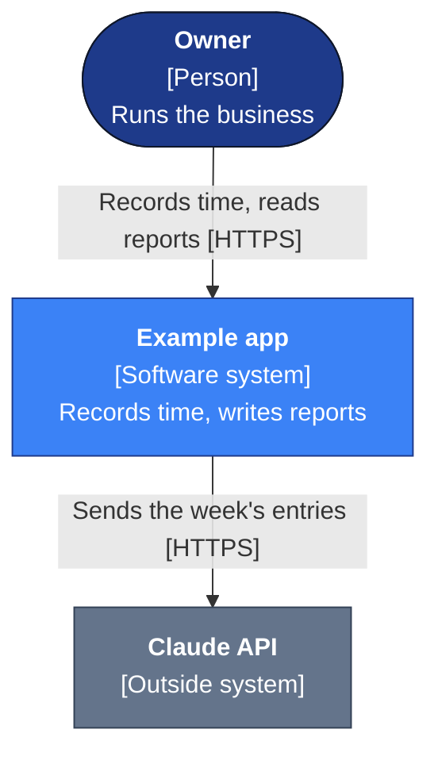

# Documentation

## Files every app has

| File | What it holds |
| --- | --- |
| `README.md` | What the app does, how to run it locally, and how to run the tests |
| `AGENTS.md` | Rules for this app only: Firebase project, URLs, data model, domain rules, and any exception to these standards with its reason |
| `CLAUDE.md` | `@AGENTS.md` and `@docs/standards/README.md`, plus anything only Claude Code needs |
| `docs/architecture/architecture.md` | A C4 Context diagram and a C4 Container diagram, then the stack, Firestore collections, rules, Cloud Functions, services, hosting and CI |
| `docs/architecture/context-map.html` | The domain-driven design context map: the app's areas, what each one owns, and how they connect to each other and to outside systems |
| `docs/standards/` | A copy of this repo's `standards/` folder. Do not edit it in the app. |

## C4 diagrams

Every `docs/architecture/architecture.md` starts with two diagrams from the [C4 model](https://c4model.com).

| Diagram | What it shows |
| --- | --- |
| Context | The app as one box, the people who use it (by role), and every outside system the app reads from or writes to, such as the Claude API or Google Calendar |
| Container | Each part that runs or stores data on its own: the Angular web app, Cloud Functions, Firestore, Firebase Auth, Cloud Storage, and any program that runs on a Mac. Each line says what passes between two parts and how, for example "Reads and writes tasks (Firestore SDK)". |

- Write both diagrams in Mermaid inside `architecture.md`. GitHub draws Mermaid from the text, so a diagram change shows in the pull request next to the code change. Do not add a diagram as an image file.
- Draw them as Mermaid `flowchart` blocks with C4 labels. Do not use Mermaid's `C4Context` and `C4Container` blocks: they place boxes in fixed rows, so the lines cross and the labels overlap. Maisie's Container diagram could not be read when drawn that way.
- Write each box's kind in square brackets under its name: `[Person]`, `[Software system]`, `[Outside system]`, or the container's technology, such as `[Angular 22, Firebase Hosting]`. Draw Firestore as a cylinder (`[( )]`) and a person as a rounded box (`([ ])`).
- Colour the boxes with the classes in the example below: navy for people, blue for the app and its containers, grey for outside systems. These colours work in GitHub's light and dark themes. Draw a group of containers, such as "on Jack's Mac", as a `subgraph` with a dashed outline and no fill.
- Keep each line label to a few words, with the technology in square brackets, for example `Reads, writes [Admin SDK]`. Long labels overlap.
- Before you commit, look at the diagram in the pull request or in the VS Code Markdown preview. Try `flowchart LR` and `flowchart TB`, and keep the one that is easier to read.
- Do not draw Component or Code diagrams. They would change in most pull requests, and the code already shows that level.
- Update the Context diagram in the same pull request when a type of user or an outside system is added or removed.
- Update the Container diagram in the same pull request when a container is added or removed, or when the way two containers connect changes.
- The C4 diagrams show the parts that run. The context map (next section) shows the business areas. Every app has both.

The layout of a Context diagram. Maisie's `docs/architecture/architecture.md` has a full Context diagram and a full Container diagram.

## Context map

Every app has a domain-driven design context map in `docs/architecture/context-map.html`. Maisie's map in `jax-assistant` is the model. Copy its layout and styles.

The map shows:

- **Each area (bounded context)**, marked core, supporting or generic. Core means the reason the app exists. Supporting means built for this app, and it serves the core. Generic means something any app of this kind would need.
- **What each area owns:** its main records, its Firestore collections, and its most important rules, such as "Times to the minute; no overlaps".
- **Each outside system** the app reads from or writes to, drawn apart from the areas, because the app does not own its data.
- **Each connection**, between two areas or between an area and an outside system, labelled with its pattern: open host service (OHS), anti-corruption layer (ACL), conformist (CF), customer and supplier (C/S) or shared kernel (SK). Use another pattern name only if none of these fits, and add it to the key.
- **A key** that explains the kinds of area and each pattern used.
- **A table of connections:** for each connection, the pattern and the file or function that does the work, for example `fta-client.ts`.
- **A footer** with the date and the commit at which the map was last checked against the code.

How to keep it:

- Keep the file self-contained. Every style stays inside it and it loads nothing from the network, so it works offline. Use the app's colour tokens and support light and dark mode.
- Link to the map from `README.md` and from `architecture.md`. Say that it must be opened in a browser, because GitHub shows only its source.
- Update the map in the same pull request when a change does any of these:
  - adds or removes an area, such as a new feature with its own records
  - adds, renames or removes a Firestore collection
  - adds or removes an outside system
  - changes how two areas connect, such as a new queue or a new read from another app's project
- When you update the map, change the date and commit in the footer.
- If the app's `docs/` folder is a hosting `public` folder, add `architecture/**` to its `ignore` list (see `security.md`).

## Keeping docs current

- Update `docs/architecture/architecture.md` in the same pull request when any of these change: the stack or a major dependency, a Firestore collection or rule, a Cloud Function, a key service, the Firebase or hosting setup, or the CI pipeline.
- Update the in-app help in the same pull request when a change is visible to users, where the app has in-app help.
- Record a domain rule in `AGENTS.md` when the code does something that looks wrong but is deliberate. Say what the rule is, where it is enforced, and what not to "fix". NTA's rule on zero-activity status report sections is an example.
- Requirements docs and implementation summaries are not required. The architecture doc, the pull request and the git history record each change. An app may keep them as an exception named in its `AGENTS.md`, as PPK does.
- An automated doc-update workflow after deploy is allowed. It is in addition to updating docs in the pull request, not a replacement for it.

## How to write

- Write in plain English for readers whose first language is not English. Do not use idioms or metaphors.
- Put the main point first.
- Use names, numbers, file paths and dates, not general descriptions.
- Use bullets and tables for rules and steps.
